# GH Archive Lakehouse

An end-to-end data engineering project that turns raw [GH Archive](https://www.gharchive.org) GitHub event data into a quality-checked, analytics-ready **galaxy schema**. It is built on **Databricks (Delta Lake, Unity Catalog)**, transformed with **PySpark** and **dbt**, and orchestrated with **Apache Airflow**.

**What it demonstrates**

- Medallion architecture (bronze, silver, gold) with separate `dev` and `prod` environments
- A rule-driven data quality framework in pure PySpark/SQL, with a quarantine table that keeps bad rows and the reason each was rejected
- Quality checks that act as a gate: gold is built only from silver data that passed
- A galaxy schema (fact constellation): 5 conformed dimensions, 7 fact tables, 5 business marts
- dbt models with 91 automated tests, run as a Databricks job and triggered by Airflow

---

## Architecture

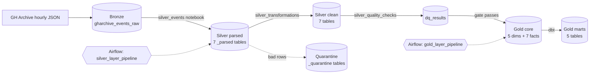

| Layer | Schema (dev / prod) | What it holds |
|---|---|---|
| Bronze | `bronze_dev` / `bronze` | Raw GH Archive events as JSON text, unchanged |
| Silver | `silver_dev` / `silver` | Parsed, cleaned, validated and enriched event tables, plus quarantine and quality results |
| Gold | `gold_dev` / `gold` | Dimensions, facts and marts for analytics |

All tables live in the `workspace` catalog and are stored as Delta tables.

## Results

Screenshots from a full production run of the medallion pipeline (Bronze → Silver → Gold), orchestrated by Airflow and executed on Databricks.

### Orchestration (Airflow)

**DAG overview**

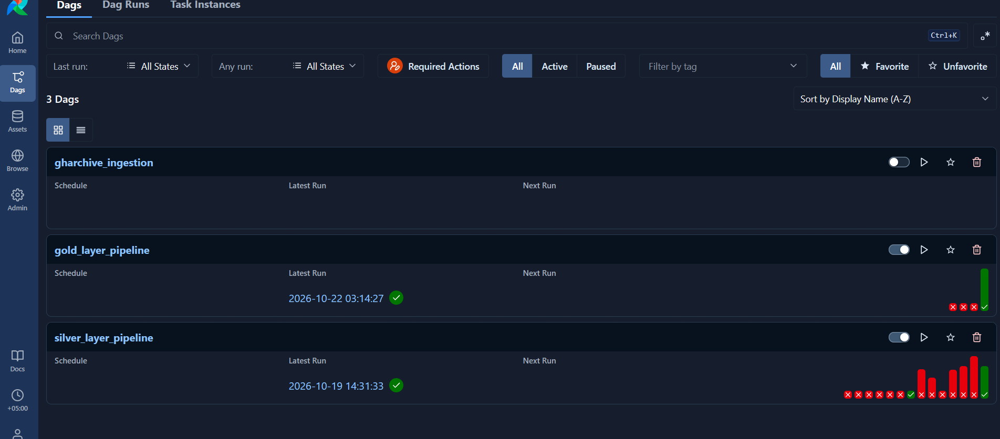

*Three DAGs: `gharchive_ingestion`, `silver_layer_pipeline` and `gold_layer_pipeline`, with recent run history for each.*

**Silver pipeline**

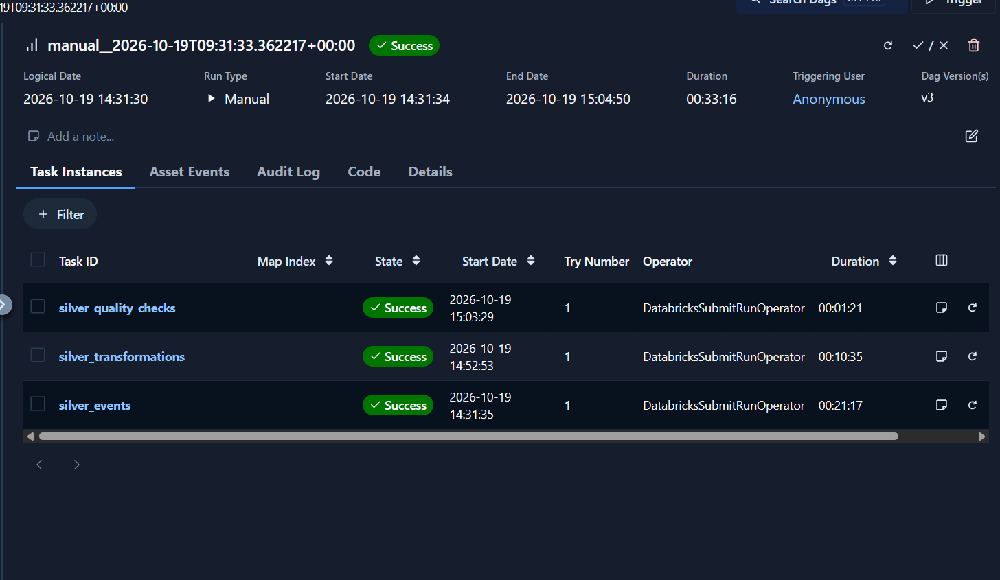

*Silver run: `silver_events`, `silver_transformations` and `silver_quality_checks` all succeeded (33m 16s total), each submitted to Databricks via `DatabricksSubmitRunOperator`.*

**Gold pipeline**

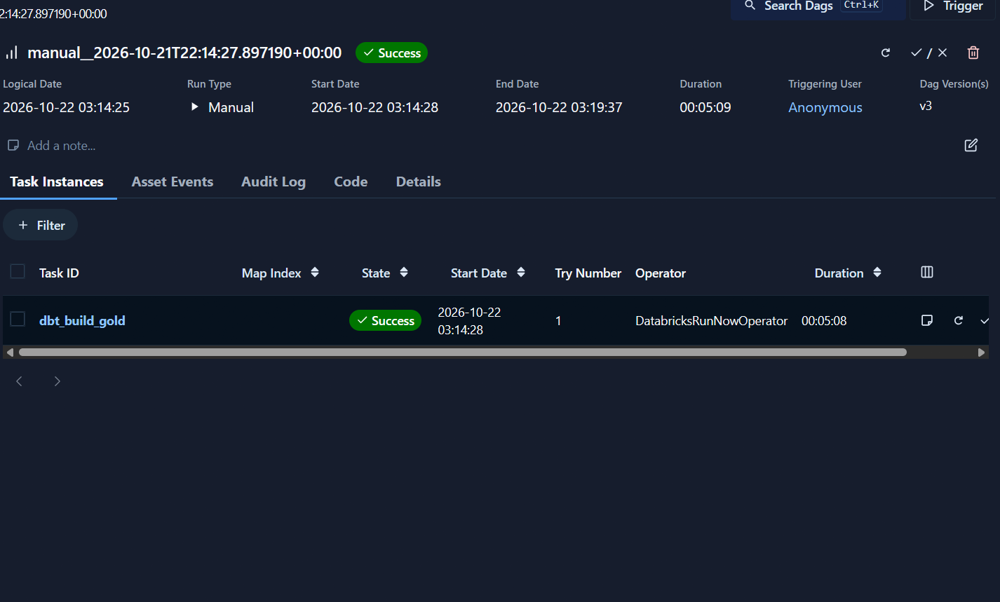

*Gold run: `dbt_build_gold` triggers the Databricks dbt job via `DatabricksRunNowOperator` and succeeded in about 5 minutes.*

### Bronze layer

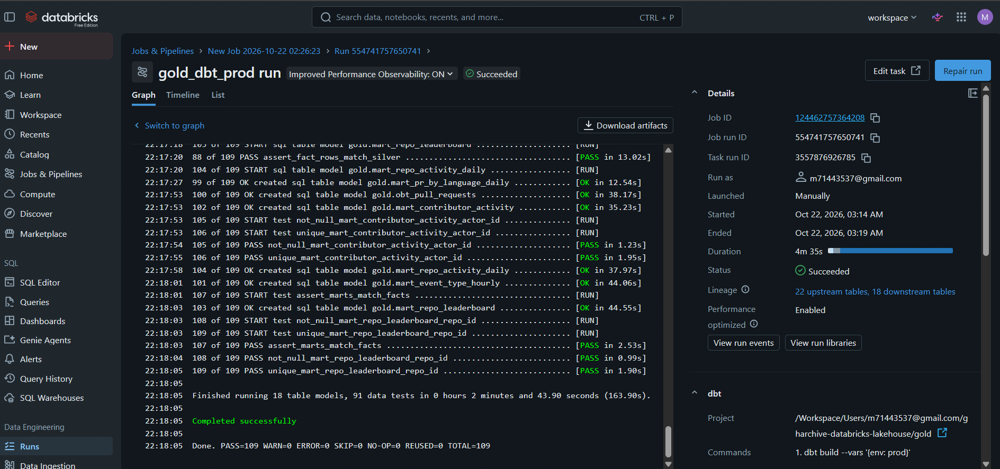

*Raw GH Archive events landed in the `raw_landing` volume and loaded into `bronze.gharchive_events_raw`, with the original JSON preserved in `raw_content`.*

### Silver layer

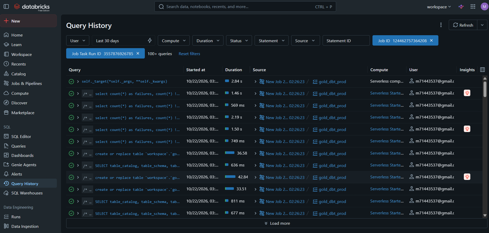

*Silver row counts across the 17 tables: per-event-type tables, parsed variants, and the quarantine table.*

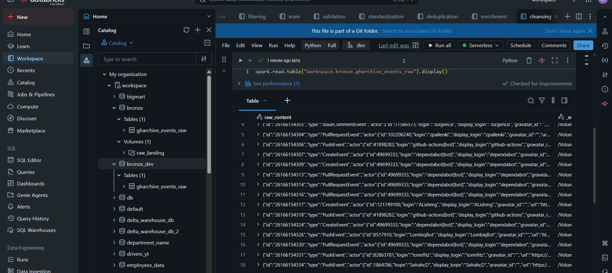

*`silver.dq_results` records every rule run: schema evolution, cleansing, and validation checks, with severity, failing rows and total rows.*

### Gold layer (dbt)

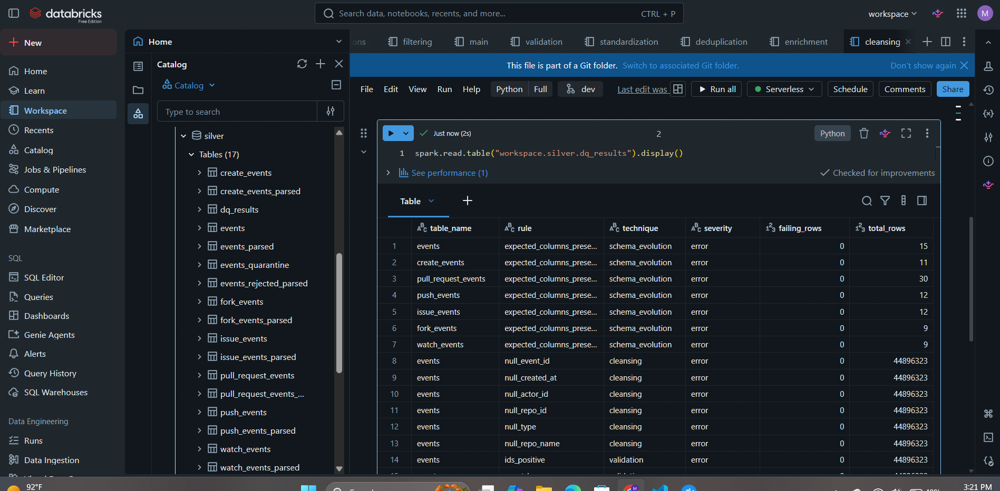

*`dbt build` on prod via the `gold_dbt_prod` job: 18 table models and 91 data tests, `PASS=109 WARN=0 ERROR=0 TOTAL=109`.*

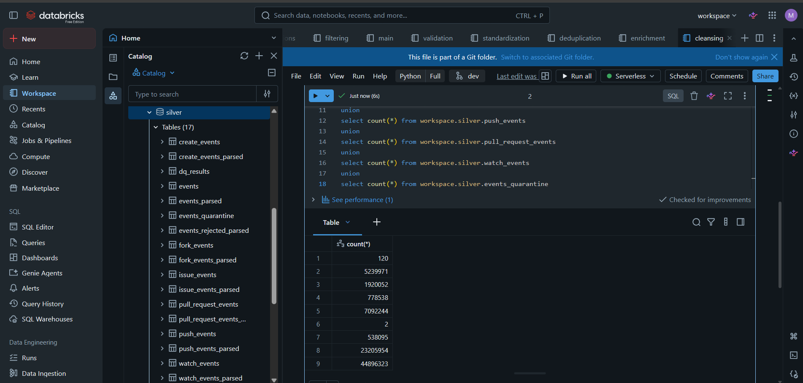

*Query History for the same job run: the `create or replace table` statements and test queries dbt issued on serverless compute.*


*Gold row counts across the 18 tables: dimensions, facts and marts.*

### Data quality

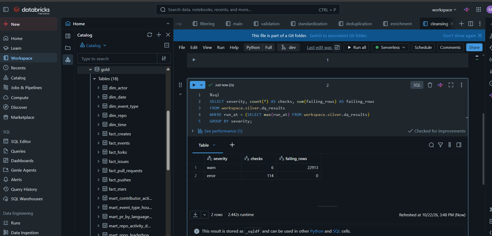

*Latest quality run: 114 error-level checks with 0 failing rows. The 6 warn-level checks flagged 22,913 rows without blocking the pipeline.*

### Gold output

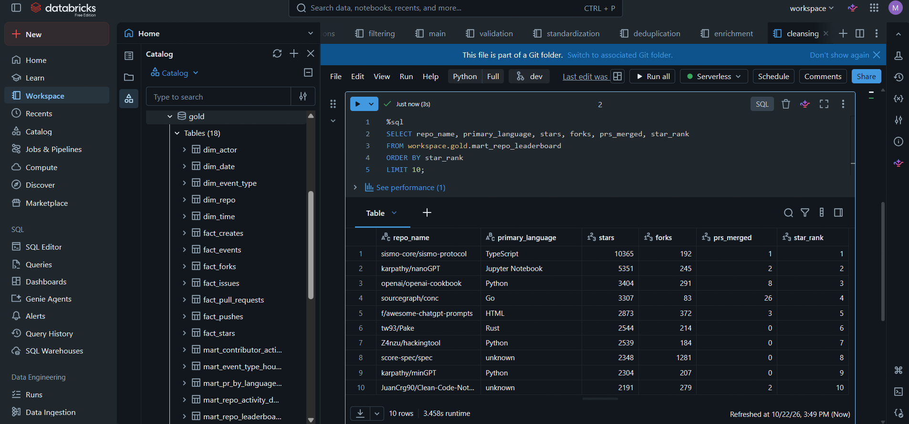

*`mart_repo_leaderboard`: top 10 repositories by stars, with language, forks and merged PRs.*

## Tech stack

| Area | Tool |
|---|---|
| Platform | Databricks Free Edition (serverless compute), Unity Catalog, Delta Lake |
| Processing | PySpark, Spark SQL |
| Modeling | dbt-core and dbt-databricks |
| Orchestration | Apache Airflow (Databricks provider) |
| Source control | Git and GitHub |

## Data source and scope

GH Archive publishes every public GitHub event as hourly JSON files. This project uses the hourly files for **2023-01-01 to 2023-01-14**. Some hours are missing because of interruptions during ingestion, and they were not backfilled.

The pipeline handles 15 event types. Six of them get their own typed table: `PushEvent`, `PullRequestEvent`, `IssuesEvent`, `WatchEvent`, `ForkEvent` and `CreateEvent`. All events are in the `events` table.

## Repository structure

```
gharchive-databricks-lakehouse/
├── airflow/
│   └── dags/
│       ├── silver_dag.py          DAG: silver_events -> silver_transformations -> silver_quality_checks
│       └── gold_dag.py            DAG: runs the Databricks job that builds gold with dbt
├── silver/
│   ├── silver_config              rules, required columns, defaults (shared by all silver notebooks)
│   ├── silver_events              parses bronze JSON into the 7 *_parsed tables
│   ├── silver_quality_checks      runs the quality rules and acts as the gate
│   └── silver_transformations/
│       ├── main                   runs the stages below for each table
│       ├── standardization        trim, lowercase, type casts
│       ├── cleansing              blanks to NULL, defaults
│       ├── enrichment             derived columns
│       ├── validation             splits good rows from bad rows
│       ├── deduplication          one row per event_id
│       └── filtering              keeps known event types
└── gold/                          dbt project
    ├── dbt_project.yml
    ├── models/
    │   ├── sources.yml            points at the clean silver tables
    │   ├── core/                  5 dimensions + 7 facts (+ schema.yml tests)
    │   ├── marts/                 5 business marts
    │   └── obt/                   optional one-big-table (off by default)
    ├── macros/date_key.sql
    └── tests/                     3 custom reconciliation tests
```

## Environments

The same code runs in both environments. A single `env` value (`dev` or `prod`) selects the schemas.

| | Dev | Prod |
|---|---|---|
| Bronze | `workspace.bronze_dev` | `workspace.bronze` |
| Silver | `workspace.silver_dev` | `workspace.silver` |
| Gold | `workspace.gold_dev` | `workspace.gold` |

- **Silver notebooks** read an `env` widget. Airflow passes it from the DAG parameter.
- **dbt** reads the silver schema from the `env` variable, falling back to the target name, and writes to the schema set on the job.

---

## Pipeline in detail

### 1. Bronze

Raw GH Archive events are stored as one JSON string per row in `gharchive_events_raw`, with the source file name and the load time. Nothing is changed here, so every later layer can be rebuilt from bronze.

### 2. Silver: parse (`silver_events`)

- Extracts the top-level fields from the JSON (`get_json_object`) into typed columns, and derives `event_date` and `event_hour`.
- Rows with no `event_id` or no `created_at` cannot be keyed or dated. They are written to `events_rejected` with a reason instead of being dropped silently.
- Duplicates on `event_id` are removed.
- The `payload` stays a JSON string. It is parsed with `from_json` and a **fixed schema** per event type, so new fields added by GitHub do not change the tables.
- Seven `*_parsed` tables are written: `events_parsed` plus one per event type. A check fails the run if more than 0.1% of payloads cannot be parsed, or if the written row count differs from the source.

### 3. Silver: transformations (`silver_transformations/main`)

For each table, `main` reads the `*_parsed` table, applies the stages in this order, and overwrites the clean table. `events` runs first so the type tables can be matched against it.

| Order | Stage | What it does |
|---|---|---|
| 1 | Standardize | Trims every string column, lowercases logins and fixed-vocabulary columns, casts `event_id` to BIGINT with `try_cast` |
| 2 | Cleanse | Turns blank strings into NULL and fills defaults for optional columns |
| 3 | Enrich | Adds derived columns such as `is_bot`, `lines_changed`, `pr_size`, `merge_time_hours`, `is_star` |
| 4 | Validate | Splits the table into good rows and bad rows, using the required-column list and the error-level rules |
| 5 | Align | Type tables keep only events that still exist in the clean `events` table |
| 6 | Deduplicate | Keeps the most recently ingested copy of each `event_id` |
| 7 | Filter | `events` keeps only the 15 known event types |

The run fails if more than **5%** of a table is quarantined, which usually means a broken rule or a broken source.

### 4. Quarantine

Bad rows are kept, not deleted. Each quarantine table has the same columns as its source table plus:

- `dq_reasons`: the names of every rule the row broke
- `quarantined_at`: when it was isolated
- `status`: currently always `pending`

Quarantine writes skip rows that are already there, so rerunning the pipeline never duplicates them. Fixing quarantined rows and merging them back is not automated yet (see next steps).

### 5. Silver: quality checks (`silver_quality_checks`)

- All rules for a table run in **one scan** (`count_if` per rule), so the check stays fast.
- Results are appended to `dq_results` on every run, which gives a history of quality over time.
- Checks include: expected columns exist, required columns are not null, value rules, key uniqueness, no orphan rows against `events`, and row counts that add up (each type table's rows plus its quarantined rows match the events of that type in `events`).
- Rules have a severity. An `error` that finds bad rows fails the notebook, which stops the Airflow DAG before gold. A `warn` is only recorded.

### 6. Gold: galaxy schema with dbt

A galaxy schema (fact constellation) has several fact tables that share the same dimensions. Here, seven facts share five conformed dimensions.

```mermaid
erDiagram
    dim_date ||--o{ fact_events : date_key
    dim_time ||--o{ fact_events : hour_key
    dim_repo ||--o{ fact_events : repo_id
    dim_actor ||--o{ fact_events : actor_id
    dim_event_type ||--o{ fact_events : event_type_key
    dim_date ||--o{ fact_pull_requests : "date_key, pr_created_date_key, merged_date_key"
    dim_time ||--o{ fact_pull_requests : hour_key
    dim_repo ||--o{ fact_pull_requests : repo_id
    dim_actor ||--o{ fact_pull_requests : actor_id
    dim_date ||--o{ fact_pushes : date_key
    dim_time ||--o{ fact_pushes : hour_key
    dim_repo ||--o{ fact_pushes : repo_id
    dim_actor ||--o{ fact_pushes : actor_id
    dim_date ||--o{ fact_issues : date_key
    dim_time ||--o{ fact_issues : hour_key
    dim_repo ||--o{ fact_issues : repo_id
    dim_actor ||--o{ fact_issues : actor_id
    dim_date ||--o{ fact_stars : date_key
    dim_time ||--o{ fact_stars : hour_key
    dim_repo ||--o{ fact_stars : repo_id
    dim_actor ||--o{ fact_stars : actor_id
    dim_date ||--o{ fact_forks : date_key
    dim_time ||--o{ fact_forks : hour_key
    dim_repo ||--o{ fact_forks : repo_id
    dim_actor ||--o{ fact_forks : actor_id
    dim_date ||--o{ fact_creates : date_key
    dim_time ||--o{ fact_creates : hour_key
    dim_repo ||--o{ fact_creates : repo_id
    dim_actor ||--o{ fact_creates : actor_id
```

- **Keys:** `repo_id` and `actor_id` are GitHub's own ids, which are stable, so they are used directly as dimension keys. `date_key` is an integer such as `20230101`, and `hour_key` is 0 to 23.
- **Role-playing date:** `fact_pull_requests` links to `dim_date` three times (event date, PR creation date, merge date).
- **Dimensions keep only the latest values** (no history).
- **Marts** are built only from the dimensions and facts, never from silver.
- **Optional OBT:** `obt_pull_requests` flattens a pull request fact with its dimensions. It is off by default and built with `dbt build --vars '{build_obt: true}'`.
- **Tests:** 91 in total. Dimension keys are unique and not null. Fact `event_id` is unique. Every foreign key finds its dimension row. Three custom tests check that each fact has as many rows as its silver table, that mart totals match the facts, and that no event has an unknown type.

### 7. Orchestration (Airflow)

| DAG | Tasks | Notes |
|---|---|---|
| `silver_layer_pipeline` | `silver_events` then `silver_transformations_main` then `silver_quality_checks` | Each task runs a Databricks notebook on serverless compute through the run-submit API. The quality task never retries. Parameters: `env`, `start_date`, `end_date` (blank dates mean all data) |
| `gold_layer_pipeline` | `dbt_build_gold` | Triggers the Databricks job that runs `dbt build`. Parameter: `env` (`dev` or `prod`), which picks the dev or prod job |

Silver and gold are separate DAGs. Gold is run after the silver quality gate has passed.

---

## Data quality rules

Every table must have these columns non-null: `event_id`, `created_at`, `actor_id`, `repo_id`. The tables below add table-specific required columns and rules. Severity `error` sends the row to quarantine (and fails the quality notebook if bad rows remain in a clean table). `warn` is recorded only.

**Rules for every table**

| Rule | Bad row when | Severity |
|---|---|---|
| ids_positive | `event_id`, `actor_id` or `repo_id` is 0 or negative | error |
| event_hour_range | `event_hour` is outside 0 to 23 | error |
| created_at_range | `created_at` is before 2011-01-01 or in the future | error |
| event_date_consistent | `event_date` differs from the date of `created_at` | error |

**Table-specific rules**

| Table | Required (also must be non-null) | Rule | Bad row when | Severity |
|---|---|---|---|---|
| events | `type`, `repo_name` | repo_name_format | `repo_name` is not `owner/repo` | error |
| events | | type_is_known | `type` is not one of the 15 known types | warn |
| events | | login_trimmed | `actor_login` has leading or trailing spaces | warn |
| create_events | `ref_type` | ref_type_valid | `ref_type` is not repository, branch or tag | warn |
| pull_request_events | `pr_id`, `pr_number`, `action`, `pr_state`, `pr_created_at`, `base_branch` | counts_not_negative | additions, deletions, changed files or commits below 0 | error |
| pull_request_events | | state_is_valid | `pr_state` is not open or closed | error |
| pull_request_events | | merged_has_timestamp | merged but `merged_at` is empty | error |
| pull_request_events | | merge_after_creation | `merged_at` is before `pr_created_at` | error |
| pull_request_events | | lines_changed_correct | `lines_changed` is not additions plus deletions | error |
| pull_request_events | | pr_size_outlier | `lines_changed` is above 100,000 | warn |
| push_events | `push_id`, `ref` | push_id_positive | `push_id` is 0 or negative | error |
| push_events | | counts_not_negative | `commit_count` or `distinct_commit_count` below 0 | error |
| push_events | | distinct_le_total | distinct commits are more than total commits | warn |
| issue_events | `issue_id`, `issue_number`, `issue_state`, `action` | issue_ids_positive | issue id or number is 0 or negative | error |
| issue_events | | comments_not_negative | `comment_count` below 0 | error |
| issue_events | | issue_state_valid | `issue_state` is not open or closed | error |
| fork_events | `forkee_id`, `forkee_name` | forkee_id_positive | `forkee_id` is 0 or negative | error |
| fork_events | | forkee_name_format | `forkee_name` is not `owner/repo` | error |
| watch_events | `action` | action_is_started | `action` is not started | warn |
| watch_events | | is_star_consistent | `is_star` differs from `action = started` | error |

---

# Data dictionary

## Bronze

### `gharchive_events_raw`

| Column | Type | Description |
|---|---|---|
| raw_content | STRING | One GH Archive event as raw JSON text, unchanged |
| _source_file | STRING | Name of the hourly GH Archive file the row came from |
| _ingested_at | TIMESTAMP | When the row was loaded into bronze |

## Silver

Each silver table exists as `<name>_parsed` (parsed, not yet cleaned) and `<name>` (clean). The clean tables are the ones gold reads. Parsed tables differ from clean tables in that `event_id` is a string, the enrichment columns are missing, and the quality stages have not run.

### `events`: one row per event

| Column | Type | Description |
|---|---|---|
| event_id | BIGINT | GitHub's unique id for the event. Primary key |
| type | STRING | Event type, for example `PushEvent` |
| actor_id | BIGINT | Id of the user who triggered the event |
| actor_login | STRING | Login of that user, trimmed and lowercased |
| repo_id | BIGINT | Id of the repository the event happened in |
| repo_name | STRING | Repository name in the form `owner/repo` |
| org_login | STRING | Login of the organization that owns the repo, if any |
| is_public | BOOLEAN | Whether the event is public |
| created_at | TIMESTAMP | When the event happened |
| payload | STRING | The event-specific JSON, kept as text |
| ingested_at | TIMESTAMP | When the row was loaded into bronze |
| _source_file | STRING | Hourly source file |
| event_date | DATE | Date of `created_at` |
| event_hour | INT | Hour of `created_at`, 0 to 23 |
| is_bot | BOOLEAN | True when the login ends with `[bot]`, or starts with `bot-` or `bot_`, or ends with `-bot` or `_bot` |

### Columns shared by the six type tables

| Column | Type | Description |
|---|---|---|
| event_id | BIGINT | Event id. Primary key, and a foreign key to `events` |
| actor_id | BIGINT | Id of the user who triggered the event |
| repo_id | BIGINT | Id of the repository |
| created_at | TIMESTAMP | When the event happened |
| event_date | DATE | Date of `created_at` |
| event_hour | INT | Hour of `created_at`, 0 to 23 |
| ingested_at | TIMESTAMP | When the row was loaded into bronze |

### `pull_request_events`: one row per pull request event

A single pull request produces several events (opened, closed, labeled, and so on), so count by `action`.

| Column | Type | Description |
|---|---|---|
| action | STRING | What happened: opened, closed, reopened, and so on (lowercased) |
| pr_number | BIGINT | Pull request number within its repository |
| pr_id | BIGINT | GitHub's global id for the pull request |
| pr_state | STRING | State at the time of the event: open or closed |
| is_draft | BOOLEAN | Whether the PR is a draft |
| is_merged | BOOLEAN | Whether the PR has been merged |
| pr_author | STRING | Login of the PR author, lowercased |
| pr_author_type | STRING | Account type of the author, for example User or Bot |
| author_association | STRING | Author's relation to the repo, for example OWNER, MEMBER, CONTRIBUTOR |
| pr_created_at | TIMESTAMP | When the PR was opened (can be years before the event) |
| merged_at | TIMESTAMP | When the PR was merged. NULL if not merged |
| closed_at | TIMESTAMP | When the PR was closed. NULL if still open |
| commit_count | BIGINT | Number of commits in the PR |
| additions | BIGINT | Lines added |
| deletions | BIGINT | Lines removed |
| lines_changed | BIGINT | Additions plus deletions |
| changed_files | BIGINT | Number of files changed |
| base_branch | STRING | Branch the PR targets |
| repo_language | STRING | Main language of the base repo, or `unknown` |
| pr_size | STRING | Size band by `lines_changed`: tiny (20 or fewer), small (up to 200), medium (up to 1,000), large (up to 5,000), xlarge (above 5,000) |
| merge_time_hours | DOUBLE | Hours from creation to merge. NULL if not merged |
| merged_hour | INT | Hour of day of the merge. NULL if not merged |
| is_bot | BOOLEAN | True when the author type is Bot or the author login ends with `[bot]` |

### `push_events`: one row per push

| Column | Type | Description |
|---|---|---|
| push_id | BIGINT | GitHub's id for the push |
| ref | STRING | Full git ref pushed to, for example `refs/heads/main` |
| head | STRING | SHA of the commit at the tip after the push |
| commit_count | BIGINT | Number of commits in the push |
| distinct_commit_count | BIGINT | Number of those commits that were new to the repo |

### `issue_events`: one row per issue event

| Column | Type | Description |
|---|---|---|
| action | STRING | opened, closed, reopened, and so on (lowercased) |
| issue_id | BIGINT | GitHub's global id for the issue |
| issue_number | BIGINT | Issue number within its repository |
| issue_state | STRING | State at the time of the event: open or closed |
| comment_count | BIGINT | Number of comments on the issue |

### `watch_events`: one row per star

| Column | Type | Description |
|---|---|---|
| action | STRING | Always `started` for a star |
| is_star | BOOLEAN | True when `action` is `started` |

### `fork_events`: one row per fork

| Column | Type | Description |
|---|---|---|
| forkee_id | BIGINT | Id of the new forked repository |
| forkee_name | STRING | Name of the fork in the form `owner/repo` |

### `create_events`: one row per branch, tag or repository creation

| Column | Type | Description |
|---|---|---|
| ref | STRING | Name of the branch or tag created. NULL for a new repository |
| ref_type | STRING | What was created: repository, branch or tag |
| master_branch | STRING | The repo's default branch, or `unknown` |
| pusher_type | STRING | Account type that created it, or `unknown` |

### `events_rejected`

Parsed events that had no `event_id` or no `created_at`. It has the columns of `events_parsed` plus:

| Column | Type | Description |
|---|---|---|
| reject_reason | STRING | Why the row was rejected |

### Quarantine tables (`events_quarantine`, `<type>_events_quarantine`)

Created when a table has bad rows. Each has the same columns as its source table plus:

| Column | Type | Description |
|---|---|---|
| dq_reasons | ARRAY<STRING> | Names of all the rules the row broke |
| quarantined_at | TIMESTAMP | When the row was quarantined |
| status | STRING | `pending` (awaiting a fix) |

### `dq_results`: history of every quality run

| Column | Type | Description |
|---|---|---|
| table_name | STRING | Table the rule ran on |
| rule | STRING | Rule name |
| technique | STRING | Category: cleansing, validation, standardization, deduplication, enrichment, filtering, joins, schema_evolution, business_rule |
| severity | STRING | `error` fails the run, `warn` is recorded only |
| failing_rows | BIGINT | Number of rows that broke the rule |
| total_rows | BIGINT | Number of rows checked |
| fail_rate | DOUBLE | `failing_rows` divided by `total_rows` |
| run_at | TIMESTAMP | When the run happened |

## Gold: dimensions

### `dim_date`: one row per calendar day

The calendar runs from January 1 of the earliest year that any date key can point to (including PR creation and merge dates) to December 31 of the last event year.

| Column | Type | Description |
|---|---|---|
| date_key | INT | Primary key, as `yyyymmdd` (for example 20230101) |
| full_date | DATE | The calendar date |
| year | INT | Year |
| quarter | INT | Quarter, 1 to 4 |
| month | INT | Month number, 1 to 12 |
| month_name | STRING | Month name |
| week_of_year | INT | Week number of the year |
| day_of_month | INT | Day of the month |
| day_of_week | INT | 1 = Sunday to 7 = Saturday |
| day_name | STRING | Name of the weekday |
| is_weekend | BOOLEAN | True for Saturday and Sunday |

### `dim_time`: one row per hour of the day

| Column | Type | Description |
|---|---|---|
| hour_key | INT | Primary key, 0 to 23 |
| hour_label | STRING | For example `09:00` |
| day_part | STRING | night (0 to 5), morning (6 to 11), afternoon (12 to 17), evening (18 to 23) |

### `dim_event_type`: one row per event type

| Column | Type | Description |
|---|---|---|
| event_type_key | INT | Primary key. `-1` is reserved for unknown types |
| event_type | STRING | GitHub event type name |
| event_category | STRING | code, collaboration, social, repository_admin, or unknown |

### `dim_actor`: one row per actor

| Column | Type | Description |
|---|---|---|
| actor_id | BIGINT | Primary key |
| actor_login | STRING | Latest login seen for the actor |
| is_bot | BOOLEAN | Bot flag from `events` |
| actor_type | STRING | `bot` or `human` |
| first_seen_date | DATE | First day the actor appears |
| last_seen_date | DATE | Last day the actor appears |
| total_events | BIGINT | Number of events by the actor |
| repos_touched | BIGINT | Number of distinct repos the actor was active in |

### `dim_repo`: one row per repository

| Column | Type | Description |
|---|---|---|
| repo_id | BIGINT | Primary key |
| repo_name | STRING | Latest repository name, `owner/repo` |
| repo_owner | STRING | The `owner` part of the name |
| org_login | STRING | Owning organization, if any |
| primary_language | STRING | Most recent known language from pull requests, or `unknown` |
| first_seen_date | DATE | First day the repo appears |
| last_seen_date | DATE | Last day the repo appears |
| total_events | BIGINT | Number of events in the repo |
| distinct_actors | BIGINT | Number of distinct actors active in the repo |

## Gold: facts

### Columns shared by the facts

| Column | Type | Description |
|---|---|---|
| event_id | BIGINT | Event id. Primary key of the fact (the grain is one event) |
| date_key | INT | Foreign key to `dim_date` (event date) |
| hour_key | INT | Foreign key to `dim_time` |
| repo_id | BIGINT | Foreign key to `dim_repo` |
| actor_id | BIGINT | Foreign key to `dim_actor` |
| actor_is_bot | BOOLEAN | Whether the actor who triggered the event is a bot |
| created_at | TIMESTAMP | When the event happened |

### `fact_events`: all events

All the shared columns plus:

| Column | Type | Description |
|---|---|---|
| event_type_key | INT | Foreign key to `dim_event_type` |
| org_login | STRING | Owning organization, if any |
| is_public | BOOLEAN | Whether the event is public |

### `fact_pull_requests`: one row per pull request event

Shared columns plus:

| Column | Type | Description |
|---|---|---|
| pr_id | BIGINT | Pull request id |
| pr_number | BIGINT | Pull request number |
| pr_created_date_key | INT | Foreign key to `dim_date` for the PR creation date |
| merged_date_key | INT | Foreign key to `dim_date` for the merge date. NULL if not merged |
| pr_author | STRING | PR author login |
| pr_author_type | STRING | Author account type |
| pr_author_is_bot | BOOLEAN | Whether the PR author is a bot |
| author_association | STRING | Author's relation to the repo |
| action | STRING | Event action: opened, closed, and so on |
| pr_state | STRING | open or closed |
| is_draft | BOOLEAN | Draft PR flag |
| is_merged | BOOLEAN | Merged flag |
| pr_size | STRING | tiny, small, medium, large or xlarge |
| repo_language | STRING | Language of the base repo |
| base_branch | STRING | Target branch |
| additions | BIGINT | Lines added |
| deletions | BIGINT | Lines removed |
| lines_changed | BIGINT | Additions plus deletions |
| changed_files | BIGINT | Files changed |
| commit_count | BIGINT | Commits in the PR |
| merge_time_hours | DOUBLE | Hours from creation to merge |
| merged_hour | INT | Hour of day of the merge |
| pr_created_at | TIMESTAMP | PR creation time |
| merged_at | TIMESTAMP | Merge time |
| closed_at | TIMESTAMP | Close time |

### `fact_pushes`: one row per push

Shared columns plus:

| Column | Type | Description |
|---|---|---|
| push_id | BIGINT | Push id |
| ref | STRING | Full git ref pushed to |
| branch | STRING | Branch name (the ref without `refs/heads/`). NULL for tag pushes |
| is_tag_push | BOOLEAN | True when the push was to a tag |
| head | STRING | SHA at the tip after the push |
| commit_count | BIGINT | Commits in the push |
| distinct_commit_count | BIGINT | New commits in the push |

### `fact_issues`: one row per issue event

Shared columns plus:

| Column | Type | Description |
|---|---|---|
| issue_id | BIGINT | Issue id |
| issue_number | BIGINT | Issue number |
| action | STRING | opened, closed, and so on |
| issue_state | STRING | open or closed |
| comment_count | BIGINT | Comments on the issue |

### `fact_stars`: one row per star

Only the shared columns. Each row is one star given to `repo_id` by `actor_id`.

### `fact_forks`: one row per fork

Shared columns plus (`repo_id` is the repository that was forked):

| Column | Type | Description |
|---|---|---|
| forkee_id | BIGINT | Id of the new fork |
| forkee_name | STRING | Name of the fork, `owner/repo` |
| forkee_owner | STRING | The `owner` part of the fork name |

### `fact_creates`: one row per creation

Shared columns plus:

| Column | Type | Description |
|---|---|---|
| ref | STRING | Name of the branch or tag. NULL for a repository |
| ref_type | STRING | repository, branch or tag |
| master_branch | STRING | Default branch of the repo |
| pusher_type | STRING | Account type that created it |

## Gold: marts

Business-ready tables built only from the dimensions and facts. Counts of pull requests use the event `action`, because one PR creates several events.

### `mart_repo_activity_daily`: repo by day

| Column | Type | Description |
|---|---|---|
| repo_id | BIGINT | Repository id |
| repo_name | STRING | Repository name |
| repo_owner | STRING | Repository owner |
| primary_language | STRING | Main language |
| date_key | INT | Date key |
| full_date | DATE | Calendar date |
| day_name | STRING | Weekday name |
| is_weekend | BOOLEAN | Weekend flag |
| total_events | BIGINT | All events that day |
| bot_events | BIGINT | Events by bots |
| active_actors | BIGINT | Distinct actors that day |
| pushes | BIGINT | Number of pushes |
| commits_pushed | BIGINT | Commits in those pushes |
| prs_opened | BIGINT | Pull requests opened |
| prs_merged | BIGINT | Pull requests closed as merged |
| issues_opened | BIGINT | Issues opened |
| issues_closed | BIGINT | Issues closed |
| stars | BIGINT | Stars received |
| forks | BIGINT | Forks created |
| branches_created | BIGINT | Branches created |

### `mart_pr_by_language_daily`: language by day

| Column | Type | Description |
|---|---|---|
| date_key | INT | Date key |
| full_date | DATE | Calendar date |
| repo_language | STRING | Language of the base repo |
| prs_opened | BIGINT | Pull requests opened |
| prs_merged | BIGINT | Pull requests closed as merged |
| bot_prs_opened | BIGINT | Opened PRs whose author is a bot |
| avg_merge_time_hours | DOUBLE | Average hours to merge, over merged PRs |
| avg_lines_changed_opened | DOUBLE | Average lines changed in opened PRs |
| lines_changed_opened | BIGINT | Total lines changed in opened PRs |

### `mart_event_type_hourly`: event type by hour

| Column | Type | Description |
|---|---|---|
| date_key | INT | Date key |
| full_date | DATE | Calendar date |
| day_name | STRING | Weekday name |
| hour_key | INT | Hour, 0 to 23 |
| hour_label | STRING | Hour label such as `09:00` |
| day_part | STRING | night, morning, afternoon or evening |
| event_type_key | INT | Event type key |
| event_type | STRING | Event type name |
| event_category | STRING | Event category |
| events | BIGINT | Number of events |
| bot_events | BIGINT | Events by bots |
| distinct_actors | BIGINT | Distinct actors |
| distinct_repos | BIGINT | Distinct repos |

### `mart_repo_leaderboard`: one row per repo, whole period

| Column | Type | Description |
|---|---|---|
| repo_id | BIGINT | Repository id |
| repo_name | STRING | Repository name |
| repo_owner | STRING | Repository owner |
| primary_language | STRING | Main language |
| total_events | BIGINT | All events |
| human_events | BIGINT | Events by non-bot actors |
| distinct_actors | BIGINT | Distinct actors |
| stars | BIGINT | Stars received |
| forks | BIGINT | Forks created |
| pushes | BIGINT | Pushes |
| commits_pushed | BIGINT | Commits pushed |
| prs_opened | BIGINT | Pull requests opened |
| prs_merged | BIGINT | Pull requests closed as merged |
| avg_merge_time_hours | DOUBLE | Average hours to merge |
| star_rank | INT | Rank by stars (1 is the most starred) |
| activity_rank | INT | Rank by total events |

### `mart_contributor_activity`: one row per human actor

| Column | Type | Description |
|---|---|---|
| actor_id | BIGINT | Actor id |
| actor_login | STRING | Actor login |
| total_events | BIGINT | All events by the actor |
| repos_touched | BIGINT | Distinct repos |
| active_days | BIGINT | Distinct days with activity |
| pushes | BIGINT | Pushes |
| commits_pushed | BIGINT | Commits pushed |
| prs_opened | BIGINT | Pull requests opened |
| prs_merged_by_actor | BIGINT | Pull requests the actor closed as merged (the merger, not necessarily the author) |
| issues_opened | BIGINT | Issues opened |
| activity_rank | INT | Rank by total events |

### `obt_pull_requests` (optional)

One row per pull request event with the dimension attributes flattened in. It contains the following columns: `event_id`, `pr_id`, `pr_number`, `action`, `pr_state`, `is_merged`, `is_draft`, `pr_size`, `additions`, `deletions`, `lines_changed`, `changed_files`, `commit_count`, `merge_time_hours`, `created_at`, `pr_created_at`, `merged_at`, `closed_at` (from the fact); `full_date`, `year`, `month`, `month_name`, `day_name`, `is_weekend` (from `dim_date`); `hour_key`, `day_part` (from `dim_time`); `repo_id`, `repo_name`, `repo_owner`, `primary_language` (from `dim_repo`); `actor_id`, `actor_login`, `actor_type` (from `dim_actor`); and `pr_author`, `pr_author_type`, `pr_author_is_bot`, `author_association`, `base_branch` (from the fact).

---

## How to run

**Prerequisites:** a Databricks workspace with a SQL warehouse, a personal access token, Airflow with the Databricks provider, and `dbt-databricks` (dbt-core 1.10.5 or newer).

1. **Create the schemas** (once per environment):
   ```sql
   CREATE SCHEMA IF NOT EXISTS workspace.silver_dev;
   CREATE SCHEMA IF NOT EXISTS workspace.silver;
   ```
   The gold schemas are created by the dbt job's target schema setting. Bronze is loaded by the ingestion step.
2. **Silver:** trigger `silver_layer_pipeline` in Airflow with `env = dev` or `prod`. Leave `start_date` and `end_date` blank to process all bronze data. The run succeeds only if `silver_quality_checks` passes.
3. **Gold:** trigger `gold_layer_pipeline` with the same `env`. It runs the Databricks job that executes `dbt build` (models and tests together).
4. **dbt on its own** (for development):
   ```bash
   cd gold
   export DATABRICKS_HOST=...        # workspace host without https://
   export DATABRICKS_HTTP_PATH=...   # from the SQL warehouse connection details
   export DATABRICKS_TOKEN=...
   dbt build --target dev  --profiles-dir .
   dbt build --target prod --profiles-dir .
   ```
5. **Airflow settings:** `DATABRICKS_NOTEBOOK_BASE` (the workspace folder with the silver notebooks) and a `databricks_default` connection with the workspace host and token.

## Design decisions

- **Parsed and clean tables are separate** (`*_parsed` and the plain names), so cleaning always starts from untouched parsed data and a rerun never reads a table it is overwriting.
- **Bad rows are quarantined, not deleted.** Silent drops hide problems. Keeping the rows with the rule names makes the cause visible.
- **Rules are data.** They live in `silver_config` as SQL predicates, so the same list drives both the quarantine split and the quality checks, and adding a rule is one line.
- **Pure PySpark and SQL instead of Deequ**, which does not run well on serverless Free Edition. All rules for a table run in a single scan.
- **A fixed payload schema** keeps table types stable when GitHub adds fields.
- **Natural keys** (`repo_id`, `actor_id`) are used as dimension keys. Generated surrogate keys would change on every full rebuild.
- **Bots are flagged, not removed.** Silver stays complete, and each analysis chooses whether to exclude them.
- **Full rebuild on every run.** It is simple and safe at this data size, and it makes every run repeatable.

## Known limitations and next steps

- The quarantine tables hold bad rows with reasons, but fixing them and merging them back is not automated yet.
- Dimensions keep only the latest values (SCD type 1). History would need SCD type 2.
- Bot detection is based on login patterns, so it can miss bots that do not follow a naming convention.
- Tables are rebuilt in full. An incremental load would be needed for a much larger volume.
- Missing hours in the source files were not backfilled.

## Author

**Muneeb**, Computer Science graduate, Government College University Faisalabad. Self-taught data engineer, open to entry-level Data Engineer roles.
